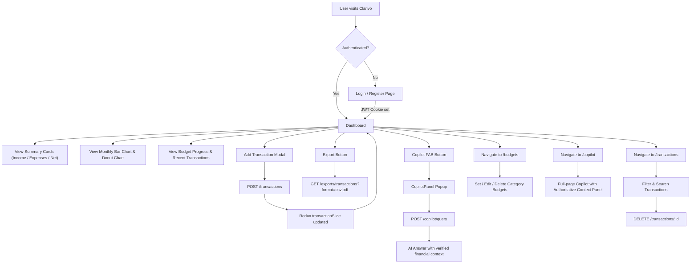
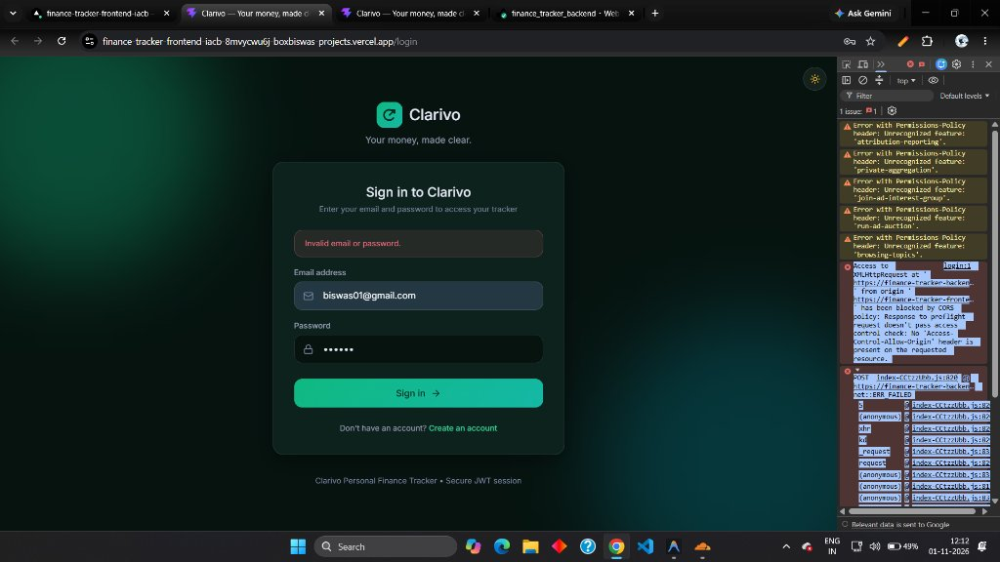
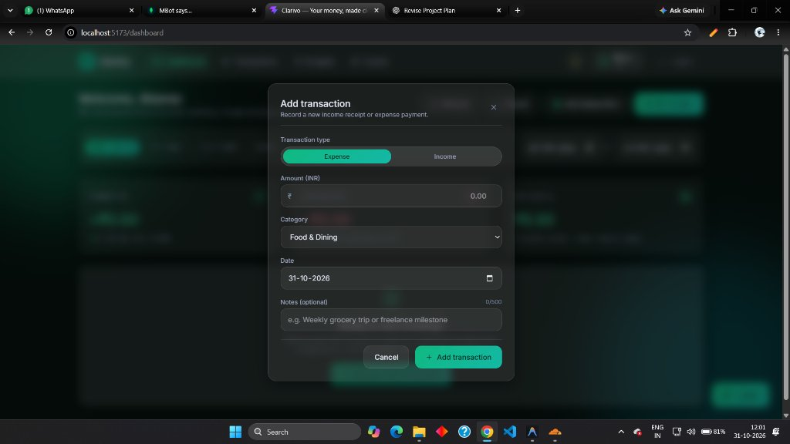
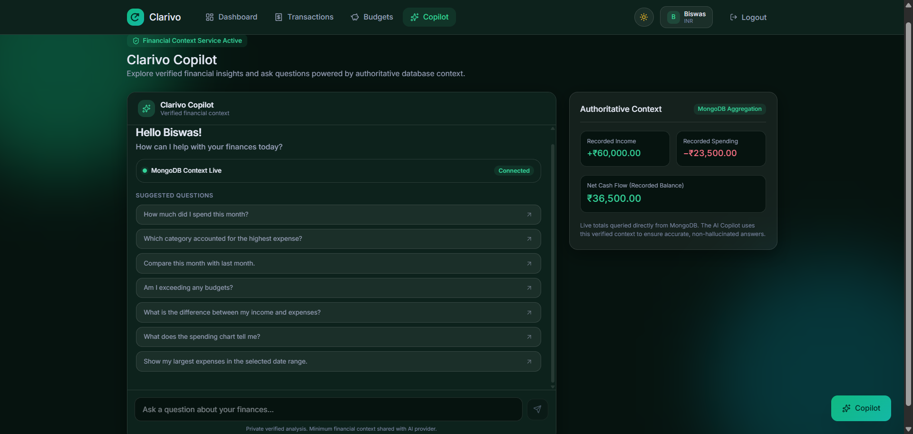
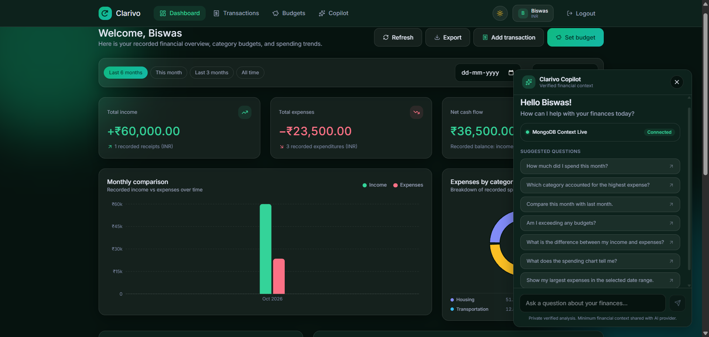
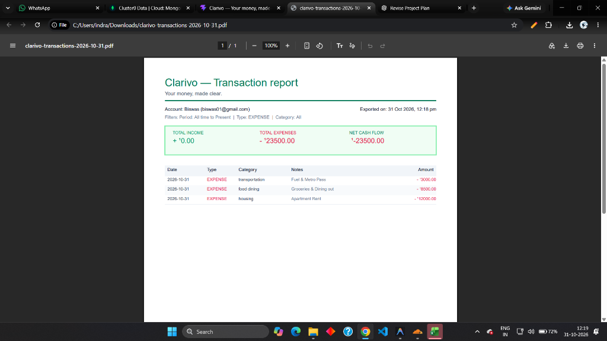

# 💰 Clarivo — Frontend (Personal Finance Tracker)

> **Your money, made clear.** A modern glassmorphism-styled personal finance web application built with **React 19**, **Vite**, **Tailwind CSS v4**, and **Redux Toolkit**. Track income and expenses, visualise spending patterns with **Recharts**, manage category budgets, and query your finances with the built-in **AI Copilot** powered by Gemini / OpenAI.

---

## 🌐 Live & Local Access

| Environment | Platform | URL |
| :--- | :--- | :--- |
| **Local Development** | Vite Dev Server | `http://localhost:5173` |
| **Production** | Vercel SPA | [https://finance-tracker-frontend-iacb.vercel.app](https://finance-tracker-frontend-iacb.vercel.app) |
| **Backend API** | Express 5 Server | `http://localhost:3000` |

---

## 📋 Table of Contents

- [Overview](#-overview)
- [System Flowchart](#-system-flowchart)
- [Key Features](#-key-features)
- [Component Architecture](#-component-architecture)
- [Folder Structure](#-folder-structure)
- [Tech Stack](#-tech-stack)
- [Design System](#-design-system)
- [State Management — Redux Slices](#-state-management--redux-slices)
- [Routing & Navigation](#-routing--navigation)
- [Environment Variables](#-environment-variables)
- [Installation & Setup](#-installation--setup)
- [Build & Deployment](#-build--deployment)
- [Available Scripts](#-available-scripts)
- [Dependencies](#-dependencies)
- [Demo Account & Testing Guide](#-demo-account--testing-guide)
- [Screenshots](#-screenshots)

---

## 🔍 Overview

**Clarivo** is a full-stack personal finance tracker designed for individuals who want complete clarity over their financial life. The frontend is a single-page application (SPA) that communicates with the Clarivo Express API to record, visualise, and analyse transactions in real time.

### What It Does

1. **Tracks Income & Expenses:** Record transactions across 8 expense and 4 income categories with optional notes.
2. **Visualises Spending:** Monthly bar chart (income vs expenses) and category donut chart powered by Recharts.
3. **Budget Management:** Set per-category monthly spending limits and track real-time consumption with overspend alerts.
4. **AI Copilot:** Ask natural language questions about your finances. Gemini answers using verified MongoDB data — not hallucinations.
5. **Filtered Analytics:** View summaries for "This month", "Last 3 months", "Last 6 months", or "All time" with custom date range support.
6. **Export to PDF / CSV:** Download formatted transaction reports from the dashboard or transactions page.
7. **Dark & Light Mode:** Full theme support with persistent preference via React Context.

---

## 🔄 System Flowchart



---

## ✨ Key Features

### 🔐 1. Authentication & Security
- **Register / Login** with full name, email, and password.
- **HTTP-Only JWT Cookies** — tokens never exposed to JavaScript, eliminating XSS token theft.
- **401 Axios Interceptor** — automatically clears Redux state and redirects to `/login` on session expiry.
- **Protected Routes** via `ProtectedRoutes.jsx` — unauthenticated users cannot access dashboard, transactions, budgets, or copilot.
- **Public Routes** via `PublicRoute.jsx` — authenticated users are redirected away from login/register.
- **Client-side Zod-like validation** — email format, name character rules, and input length checked before API calls.

### 📊 2. Dashboard & Analytics
- **Three summary cards:** Total Income (+₹), Total Expenses (−₹), Net Cash Flow (₹).
- **Date range filters:** This month · Last 3 months · Last 6 months · All time · Custom date picker.
- **Monthly Bar Chart** (Recharts `BarChart`) — side-by-side income and expense bars per month.
- **Category Donut Chart** (Recharts `PieChart`) — spending breakdown by category with percentage labels.
- **Budget Progress Strip** — compact progress bars for each category budget showing % consumed.
- **Recent Transactions List** — the latest 5 transactions with category icon, note, and amount.

### 💸 3. Transaction Management
- **Add Transaction** via modal form — type (Income/Expense), amount (INR), category, date, optional notes.
- **Transaction Table** — sortable list with category badge, type, date, notes, and delete action.
- **Filter & Search** — filter by type (income/expense), category, and date range.
- **Delete with Confirmation** modal to prevent accidental removal.
- **Export to CSV or PDF** with current filters applied.

### 🎯 4. Budget Manager
- **Set monthly budgets** per spending category.
- **Real-time progress bars** — green (under budget), amber (≥80%), red (over budget / overspend).
- **Summary cards** — total budget allocated, total spent, and number of categories over limit.
- **Edit & Delete** existing budgets inline.

### 🤖 5. AI Copilot
- **Floating widget** (FAB) available on every page — open an inline chat popup without leaving the current view.
- **Full-page Copilot** at `/copilot` — with an Authoritative Context panel showing live MongoDB figures.
- **Suggested questions** shown on first load to guide users.
- **Server-verified answers** — the backend fetches live data from MongoDB and injects it into the AI prompt, so answers are always grounded in real data.
- **MongoDB Context indicator** — green "Connected" badge confirms live data is in scope.

### 🌙 6. Dark & Light Mode
- Toggle via sun/moon icon in the Navbar.
- Preference stored in `ThemeContext` and applied via Tailwind's `dark:` variant.
- Full dark and light glassmorphism support across all pages.

### 📄 7. PDF & CSV Export
- **PDF** — formatted Clarivo Transaction Report with account details, summary box, and itemised table. Rendered server-side with PDFKit using Inter font for full ₹ symbol support.
- **CSV** — raw transaction data compatible with Excel / Google Sheets.

---

## 🧩 Component Architecture

```
src/
├── App.jsx                          # Root router, Redux Provider, ThemeProvider, Toaster
├── main.jsx                         # Vite entry point
├── index.css                        # Tailwind v4 directives + CSS custom properties
│
├── pages/
│   ├── LoginPage.jsx                # Public auth page
│   ├── RegisterPage.jsx             # Public registration page
│   ├── DashboardPage.jsx            # Protected — main analytics hub
│   ├── TransactionsPage.jsx         # Protected — full transaction list & filters
│   ├── BudgetsPage.jsx              # Protected — budget CRUD management
│   └── CopilotPage.jsx              # Protected — full-page AI Copilot with context panel
│
├── components/
│   ├── Navbar.jsx                   # Top navigation, theme toggle, logout
│   ├── ProtectedRoutes.jsx          # Route guard — redirects unauthenticated users
│   ├── PublicRoute.jsx              # Redirects authenticated users away from auth pages
│   │
│   ├── auth/
│   │   ├── LoginForm.jsx            # Email + password form
│   │   └── RegisterForm.jsx         # Full name + email + password form
│   │
│   ├── dashboard/
│   │   ├── DashboardHeader.jsx      # Welcome text, action buttons (Refresh, Export, Add, Budget)
│   │   ├── DashboardSummaryCards.jsx # Three KPI cards — income, expenses, net flow
│   │   ├── DashboardBudgetProgress.jsx # Compact budget strip on dashboard
│   │   ├── DashboardRecentTransactions.jsx # Last 5 transactions preview
│   │   └── DashboardEmptyState.jsx  # Shown when no transactions exist
│   │
│   ├── charts/
│   │   ├── MonthlyBarChart.jsx      # Recharts BarChart — monthly income vs expenses
│   │   ├── CategoryPieChart.jsx     # Recharts PieChart — category spending donut
│   │   ├── TrendsLineChart.jsx      # Line chart for multi-month trend view
│   │   ├── ChartTooltip.jsx         # Custom styled tooltip component
│   │   └── AnalyticsDateFilter.jsx  # Period pill buttons + custom date range inputs
│   │
│   ├── transactions/
│   │   ├── TransactionForm.jsx      # Add transaction modal form
│   │   ├── TransactionTable.jsx     # Full sortable transaction table
│   │   ├── TransactionCard.jsx      # Mobile-friendly transaction card
│   │   ├── TransactionFilters.jsx   # Type / category / date filter bar
│   │   ├── TransactionHistory.jsx   # History wrapper with pagination logic
│   │   ├── TransactionSkeleton.jsx  # Loading skeleton placeholder
│   │   ├── TransactionEmptyState.jsx # No transactions illustration
│   │   ├── TransactionErrorState.jsx # API error display
│   │   ├── DeleteConfirmation.jsx   # Delete confirmation dialog
│   │   └── ExportMenu.jsx           # CSV / PDF export dropdown
│   │
│   ├── budgets/
│   │   ├── BudgetForm.jsx           # Create / edit budget modal
│   │   ├── BudgetProgressRow.jsx    # Single budget row with progress bar
│   │   ├── BudgetSummaryCards.jsx   # Total allocated / spent / over-limit cards
│   │   ├── DashboardBudgetProgress.jsx # Budget strip on dashboard
│   │   ├── DeleteBudgetModal.jsx    # Budget delete confirmation
│   │   └── BudgetEmptyState.jsx     # No budgets illustration
│   │
│   ├── copilot/
│   │   ├── CopilotPanel.jsx         # Floating popup copilot widget
│   │   ├── CopilotHeader.jsx        # Title, verified badge, close/delete buttons
│   │   ├── CopilotInput.jsx         # Message input with send button
│   │   ├── CopilotMessageList.jsx   # Scrollable message history
│   │   ├── CopilotMessage.jsx       # Individual message bubble (user / AI)
│   │   ├── CopilotSuggestions.jsx   # Suggested question chips
│   │   ├── CopilotLoading.jsx       # Typing indicator animation
│   │   └── CopilotError.jsx         # API error state within copilot
│   │
│   └── ui/
│       └── Logo.jsx                 # Clarivo logo mark with emerald gradient
│
├── context/
│   └── ThemeContext.jsx             # Dark/light mode context + localStorage persistence
│
├── hooks/
│   ├── useTheme.js                  # Consumes ThemeContext
│   └── useChartColors.js           # Returns theme-aware Recharts colour palettes
│
├── layouts/
│   └── AppBackground.jsx            # Animated gradient background wrapper
│
├── redux/
│   ├── store.js                     # Redux store with all slices
│   └── slices/
│       ├── authSlice.js             # user, isAuthenticated, loading, error
│       ├── transactionSlice.js      # transactions[], loading, error, filters
│       ├── analyticsSlice.js        # summary, categoryBreakdown, monthlyTrends
│       ├── budgetSlice.js           # budgets[], loading, error
│       └── copilotSlice.js          # messages[], loading, error, contextSummary
│
├── https/
│   └── axios.js                     # Axios instance with baseURL, credentials, 401 interceptor
│
└── utils/
    ├── formatCurrency.js            # ₹ INR formatter (Intl.NumberFormat)
    └── categoryColors.js            # Category → colour mapping for charts & badges
```

---

## 📂 Folder Structure

```
frontend/
├── public/
│   ├── screenshots/                 # App screenshots for README
│   └── vite.svg
├── src/                             # (see Component Architecture above)
├── index.html                       # Vite HTML entry with <div id="root">
├── vite.config.js                   # Vite + @tailwindcss/vite plugin config
├── package.json
├── .env                             # Local environment variables (not committed)
├── .env.example                     # Placeholder template — safe to commit
├── .gitignore
└── vercel.json                      # SPA rewrite rule for Vercel deployment
```

---

## 🛠️ Tech Stack

| Technology | Version | Purpose |
| :--- | :--- | :--- |
| **React** | ^19.3.1 | UI framework with concurrent features |
| **Vite** | ^8.3.5 | Lightning-fast build tool & dev server |
| **Tailwind CSS** | ^4.3.3 | Utility-first CSS via `@tailwindcss/vite` plugin |
| **Redux Toolkit** | ^2.13.0 | Global state management with `createSlice` & `createAsyncThunk` |
| **React Router DOM** | ^7.18.4 | Client-side SPA routing |
| **Recharts** | ^3.10.1 | Composable financial charts (BarChart, PieChart, LineChart) |
| **Axios** | ^1.21.0 | HTTP client with interceptor for 401 auto-logout |
| **Lucide React** | ^1.62.0 | Consistent icon set |
| **React Toastify** | ^11.1.0 | Non-blocking success / error toast notifications |

---

## 🎨 Design System

Clarivo uses a custom **Emerald Glassmorphism** design language:

| Token | Value | Usage |
| :--- | :--- | :--- |
| Primary | `#10b981` (emerald-500) | Buttons, active states, income indicators |
| Danger | `#ef4444` (red-500) | Expenses, overspend, error states |
| Warning | `#f59e0b` (amber-500) | Budget warnings (≥80% consumed) |
| Glass card | `bg-white/5 backdrop-blur-sm border border-white/10` | All cards in dark mode |
| Light card | `bg-white border border-gray-100 shadow-sm` | Cards in light mode |
| Border radius | `rounded-xl` / `rounded-2xl` | Consistent card corners |
| Font | System sans-serif stack | Clean, readable at all sizes |

**Glassmorphism modals** use a solid dark background (`bg-gray-900/95`) with `backdrop-blur-md` and an `rgba` backdrop overlay to keep the form fully legible against any background.

---

## 📦 State Management — Redux Slices

### `authSlice`
```js
{ user: { name, email }, isAuthenticated: bool, loading: bool, error: string | null }
```
Actions: `loginUser`, `registerUser`, `logoutUser`, `fetchCurrentUser`

### `transactionSlice`
```js
{ transactions: [], loading: bool, error: string | null, filters: { type, category, startDate, endDate } }
```
Actions: `fetchTransactions`, `addTransaction`, `deleteTransaction`

### `analyticsSlice`
```js
{ summary: { totalIncome, totalExpenses, netCashFlow, incomeCount, expenseCount },
  categoryBreakdown: [], monthlyTrends: [], loading: bool, error: string | null }
```
Actions: `fetchSummary`, `fetchCategoryBreakdown`, `fetchMonthlyTrends`

### `budgetSlice`
```js
{ budgets: [{ category, limit, spent, percentage }], loading: bool, error: string | null }
```
Actions: `fetchBudgets`, `createBudget`, `updateBudget`, `deleteBudget`

### `copilotSlice`
```js
{ messages: [{ role: 'user'|'assistant', content: string }],
  loading: bool, error: string | null, contextSummary: {} }
```
Actions: `sendCopilotQuery`, `fetchContextSummary`, `clearMessages`

---

## 🗺️ Routing & Navigation

| Path | Component | Access | Description |
| :--- | :--- | :--- | :--- |
| `/login` | `LoginPage.jsx` | Public | Email + password authentication |
| `/register` | `RegisterPage.jsx` | Public | New account registration |
| `/dashboard` | `DashboardPage.jsx` | 🔒 Protected | Analytics hub — charts, summary, budgets |
| `/transactions` | `TransactionsPage.jsx` | 🔒 Protected | Full transaction list with filters & export |
| `/budgets` | `BudgetsPage.jsx` | 🔒 Protected | Category budget CRUD and progress tracking |
| `/copilot` | `CopilotPage.jsx` | 🔒 Protected | Full-page AI Copilot with Authoritative Context panel |
| `/` | Redirect | — | Redirects to `/dashboard` |

---

## ⚙️ Environment Variables

Create a `.env` file in the `frontend/` directory. **Never commit actual values.**

```env
# URL of the running Clarivo backend API
# Local development: http://localhost:3000
# Production: your deployed backend URL
VITE_API_URL=<your_backend_api_url>
```

> [!IMPORTANT]
> All Vite environment variables **must** be prefixed with `VITE_` to be accessible in the browser bundle. The Axios instance reads `import.meta.env.VITE_API_URL` at build time.

---

## 🚀 Installation & Setup

### Prerequisites
- **Node.js** ≥ 18.x
- **npm** ≥ 9.x
- A running Clarivo backend (see `backend/README.md`)

### Steps

```bash
# 1. Clone the repository
git clone <your-repo-url>
cd FINANCE_TRACKER/frontend

# 2. Install dependencies
npm install

# 3. Create your environment file
cp .env.example .env
# Edit .env and set VITE_API_URL=http://localhost:3000

# 4. Start the development server
npm run dev
```

Open [http://localhost:5173](http://localhost:5173) in your browser.

---

## 🏗️ Build & Deployment

### Local Production Build

```bash
npm run build       # Outputs to frontend/dist/
npm run preview     # Serves the dist/ folder locally
```

### Vercel Deployment

The `vercel.json` at the project root handles SPA routing rewrites so deep links (e.g. `/dashboard`) work on refresh:

```json
{
  "rewrites": [{ "source": "/(.*)", "destination": "/index.html" }]
}
```

**Deploy steps:**
1. Push to your Git repository.
2. Import the project in [vercel.com](https://vercel.com) → select the `frontend/` directory as root.
3. Set environment variable `VITE_API_URL` to your production backend URL.
4. Vercel auto-builds on every push to `main`.

**Live URL:** [https://finance-tracker-frontend-iacb.vercel.app](https://finance-tracker-frontend-iacb.vercel.app)

---

## 📜 Available Scripts

| Script | Command | Description |
| :--- | :--- | :--- |
| Dev server | `npm run dev` | Starts Vite dev server at `localhost:5173` with HMR |
| Build | `npm run build` | Compiles & bundles for production into `dist/` |
| Preview | `npm run preview` | Serves the production `dist/` build locally |
| Lint | `npm run lint` | Runs ESLint across all source files |

---

## 📦 Dependencies

<details>
<summary><strong>Production Dependencies</strong></summary>

| Package | Version | Purpose |
| :--- | :--- | :--- |
| `react` | ^19.3.1 | Core UI library |
| `react-dom` | ^19.3.1 | React DOM renderer |
| `react-router-dom` | ^7.18.4 | Client-side routing |
| `@reduxjs/toolkit` | ^2.13.0 | Redux state management |
| `react-redux` | ^9.2.0 | React bindings for Redux |
| `axios` | ^1.21.0 | HTTP requests with interceptors |
| `recharts` | ^3.10.1 | Composable chart library |
| `lucide-react` | ^1.62.0 | Icon components |
| `react-toastify` | ^11.1.0 | Toast notification system |

</details>

<details>
<summary><strong>Development Dependencies</strong></summary>

| Package | Version | Purpose |
| :--- | :--- | :--- |
| `vite` | ^8.3.5 | Build tool & dev server |
| `@vitejs/plugin-react` | ^4.7.0 | React Fast Refresh for Vite |
| `@tailwindcss/vite` | ^4.3.3 | Tailwind CSS v4 Vite integration |
| `tailwindcss` | ^4.3.3 | Utility-first CSS framework |
| `eslint` | ^9.x | JavaScript linter |

</details>

---

## 🧪 Demo Account & Testing Guide

A pre-seeded demo account is available for testing all features:

| Field | Value |
| :--- | :--- |
| **Email** | `biswas01@gmail.com` |
| **Password** | `123456` |

### Testing Checklist

- [ ] **Login** at `/login` with demo credentials
- [ ] **Dashboard** — verify income (+₹60,000), expenses (−₹23,500), net (₹36,500)
- [ ] **Date filters** — switch between "Last 6 months", "This month", "Last 3 months", "All time"
- [ ] **Charts** — confirm bar chart shows Oct 2026 data; donut shows Housing / Food & Dining / Transportation
- [ ] **Add transaction** — click "Add transaction", enter amount, pick category, submit
- [ ] **Transactions page** — verify the new transaction appears; test type/category filters
- [ ] **Delete transaction** — click delete, confirm in modal
- [ ] **Budgets page** — set a housing budget of ₹10,000 and observe overspend indicator
- [ ] **Export CSV** — download and open in Excel/Sheets
- [ ] **Export PDF** — open PDF, verify ₹ symbols render correctly
- [ ] **Copilot (widget)** — open from FAB, ask "How much did I spend this month?"
- [ ] **Copilot (full page)** — navigate to `/copilot`, check Authoritative Context panel figures
- [ ] **Dark / Light mode** — toggle the theme icon in the navbar

---

## 📸 Screenshots

### Dashboard — Financial Overview


### Add Transaction Modal


### Copilot — Full Page with Authoritative Context


### Dashboard with Copilot Widget Open


### PDF Export Report


---

*Built with ❤️ — Clarivo, your money made clear.*
